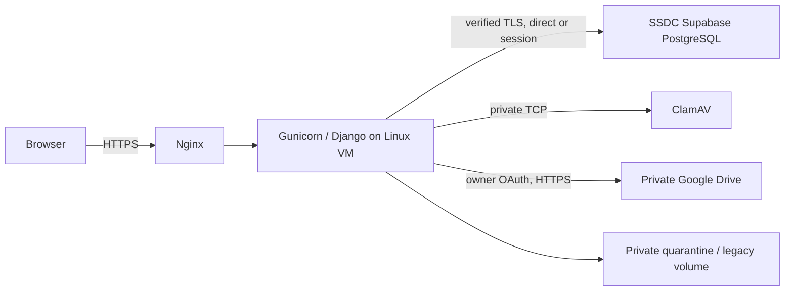

# Hosted pilot: Supabase PostgreSQL and private Google Drive

Prepared 15 October 2026, Asia/Kathmandu. This is a deployment plan for review;
no public deployment or resource provisioning has occurred.

**Status note, 16 October 2026:** the stated priority is now **zero recurring
hosting cost**, and an organisation-controlled computer is available. The
preferred route is therefore self-hosting the existing `compose.prod.yaml`
stack on that machine behind a Cloudflare Tunnel — see
[HOSTING_SETUP.md](HOSTING_SETUP.md#self-hosting-on-an-ssdc-computer-with-cloudflare-tunnel).
That route uses local PostgreSQL and does **not** need Supabase. This document
remains the plan of record for the remote-database variant, kept as the
fallback if the office machine is rejected. Firebase and serverless hosting are
excluded; the reasons are recorded in the same section. Use the standalone
`compose.pilot.yaml`. Do not combine it with `compose.prod.yaml` (the existing
self-hosted PostgreSQL option). Django retains authentication, MFA and document
authorization. Supabase supplies PostgreSQL only; no Auth/Storage/API keys are needed.



## Selected architecture and remaining inputs

The user selected an x86-64 Linux VM with at least 4 GiB, preferring free hosting.
Recommend **8 GiB RAM**: ClamAV gets a 4 GiB ceiling, app 1.5 GiB, plus OS/proxy
and build headroom. Signature reloads briefly keep two engines in memory.
[ClamAV recommends 3 GiB minimum, 4 GiB preferred](https://docs.clamav.net/manual/Installing/Docker.html).

The intended Supabase project is **SSDC**. The connected account exposes only
**Daynotes**, which has not been queried or modified. Connect the organization
containing SSDC or privately configure SSDC's database bindings on the VM.
Confirm its non-secret project ref and dedicated use before any connection or
migration. No database passwords, OAuth secrets, keys or tokens belong in chat.

No provider/account, region or hostname has been selected. Provide a hostname
under your control, preferably `vault.<your-existing-domain>`, with DNS control
to point its A record (and working AAAA if used) at the VM. The template uses the
reserved, non-resolving `REPLACE_WITH_HOSTNAME.invalid`. Production OAuth and
HTTPS configuration must wait for the actual hostname.

## Free-plan feasibility and costs

Official limits checked 15 October 2026; account eligibility/capacity are unverified.

| Option | Current limitation | Decision |
| --- | --- | --- |
| Oracle Always Free x86 | Up to two E2.1.Micro instances, 1 GiB each, home region; capacity/idle reclamation apply | Insufficient scanner memory; separate VMs do not combine RAM. |
| Oracle Always Free A1 | ARM; documented allowance equivalent to 2 OCPUs/12 GiB | Outside selected x86 architecture; requires a separately tested ARM release and agreement. |
| Google ongoing free VM | Eligible e2-micro in selected US regions; limited disk/egress | Does not meet this stack's memory requirement. |
| Google Cloud trial | Eligible new accounts: $300 credit, up to 90 days; resources stop without paid upgrade at expiry/exhaustion | Possible temporary x86 pilot, subject to eligibility, complete cost estimate and explicit approval. |
| Render free web | Sleeps after 15 idle minutes; no persistent disk | Cannot preserve quarantine/legacy files. |
| Koyeb free instance | 512 MB RAM, 0.1 vCPU, 2 GB SSD | Cannot run this stack's scanner. |

Sources: [Oracle allocations](https://docs.oracle.com/en-us/iaas/Content/FreeTier/freetier_topic-Always_Free_Resources.htm),
[Oracle eligibility](https://www.oracle.com/cloud/free/faq/),
[Google free program](https://docs.cloud.google.com/free/docs/free-cloud-features),
[Render limits](https://render.com/docs/free),
[Koyeb instances](https://www.koyeb.com/docs/reference/instances).
No suitable ongoing-free x86 VM was established from these options. Do not weaken
scanning to fit them. A credit-funded pilot is temporary. Before provisioning,
record the chosen shape/region/account eligibility, compute, disk, public IP,
egress and backup charges, credit expiry and exit date; show the total for approval.
No paid VM price is quoted without a provider/region selection. Domain/Drive/
backup storage may cost separately. Budget alerts are not hard spending caps.

Supabase Free currently includes 500 MB database size, 5 GB egress, pauses after
one inactive week, and has no included automatic backups/PITR. SSDC's actual plan
is not accessible yet. Monitor metadata/audit/session growth: free DB size limits
can make the DB read-only, breaking session/audit/upload writes. Connection limits
depend on compute and pool settings; check the dashboard rather than assuming a
pooler client ceiling equals the backend limit. Restore paused projects and check
readiness before use. No production availability or backup guarantee is assumed.
[Pricing](https://supabase.com/pricing),
[database size](https://supabase.com/docs/guides/platform/database-size),
[pooling limits](https://supabase.com/docs/guides/database/connecting-to-postgres/pooling-and-limits),
[backups](https://supabase.com/docs/guides/platform/backups).

## Database transport and scoped roles

Default: **session pooler, port 5432**, for IPv4 compatibility. Copy SSDC's exact
host from its Connect dialog, never infer it from region. Users are
`ssdc_runtime.<project-ref>` and `ssdc_migrator.<project-ref>`; DB is normally
`postgres`, subject to confirmation. If the VM has verified IPv6, direct 5432 is
appropriate: set `POSTGRES_CONNECTION_MODE=direct`, use the direct host and users
`ssdc_runtime`/`ssdc_migrator` without suffixes. Database roles are separate from
Django staff accounts and Supabase dashboard login.

**Do not use transaction pooling.** Scanner processing holds PostgreSQL session
advisory locks across transactions; disabling prepared statements would not fix
that incompatibility. Settings reject transaction mode and port 6543. Keep
session behavior/cursors intact. Gunicorn has 2 workers × 2 threads (about four web
DB connections), plus health/jobs/migrations/backups and Supabase's own connections.
Session poolers reserve backends while clients stay connected; leave headroom.
`POSTGRES_CONN_MAX_AGE` defaults to 60 in production (0–600 supported), with health
checks before reused connections and a five-second connect timeout.
[Supabase modes](https://supabase.com/docs/guides/database/connecting-to-postgres),
[Django connection behavior](https://docs.djangoproject.com/en/5.2/ref/databases/).

Remote production TLS requires `verify-full`; pilot Compose fixes that setting.
Download the trust certificate for the **selected endpoint** from Supabase DB
Settings. For a shared pooler with a different chain, use its appropriate trusted
CA bundle. Mount via `POSTGRES_SSLROOTCERT_FILE`; Django receives
`POSTGRES_SSLROOTCERT`. Verify chain/hostname with libpq, never downgrade to
`require` (encryption without server authentication), substitute an IP, or disable
verification. Enable Supabase SSL enforcement after checking other clients.
The old self-hosted production Compose explicitly disables TLS only for `db` on
its isolated Docker network; that exception does not apply to the remote pilot.

Use a **dedicated SSDC database/project**: `configure_runtime_role` currently
operates on public-schema tables and must not run in a shared application DB.
Disable Supabase's **Data API** before creating Django tables. Keep these tables
out of REST/GraphQL exposure and remove migration-owner default grants to API
roles. Do not depend on the upcoming default-grant change for existing tables.
Re-enabling Data API requires a separate grants/RLS review; Django users do not
map to Supabase Auth identities.
[Data API grants change](https://supabase.com/changelog/45329-breaking-change-tables-not-exposed-to-data-and-graphql-api-automatically).

Privately connect as the project operator with `psql` and protected libpq service/
password files, not credential-bearing URLs or shell history. Confirm
`SELECT current_database(), current_user;` and inspect public tables first.
Stop if another application owns them. In a new dedicated SSDC DB, create once:

```sql
CREATE ROLE ssdc_migrator LOGIN NOSUPERUSER NOCREATEDB NOCREATEROLE NOREPLICATION NOBYPASSRLS;
CREATE ROLE ssdc_runtime LOGIN NOSUPERUSER NOCREATEDB NOCREATEROLE NOREPLICATION NOBYPASSRLS;
GRANT CONNECT ON DATABASE postgres TO ssdc_migrator, ssdc_runtime;
GRANT USAGE, CREATE ON SCHEMA public TO ssdc_migrator;
GRANT USAGE ON SCHEMA public TO ssdc_runtime;
REVOKE CREATE ON SCHEMA public FROM PUBLIC;
ALTER DEFAULT PRIVILEGES FOR ROLE ssdc_migrator IN SCHEMA public
  REVOKE ALL ON TABLES FROM anon, authenticated, service_role;
ALTER DEFAULT PRIVILEGES FOR ROLE ssdc_migrator IN SCHEMA public
  REVOKE ALL ON SEQUENCES FROM anon, authenticated, service_role;
```

**Password handling — corrected 16 October 2026.** The earlier instruction to
set passwords "from the corresponding private generated files" was wrong in a
way that cannot work as written: psql's `\password` is **interactive only**. It
prompts twice on a terminal and cannot read a file, a pipe or a heredoc, so it
fails under `psql -f`, under any non-TTY automation and inside a `docker compose
run` without a TTY. Use it correctly as follows:

- Open an interactive psql session on a TTY, then run `\password ssdc_migrator`
  and `\password ssdc_runtime`, **pasting** each generated value at the prompt.
  `\password` hashes the value client-side (SCRAM) and sends `ALTER ROLE ...
  PASSWORD '<hash>'`, so no cleartext password reaches the server or its logs.
  This is why `\password` is preferred over a hand-written `ALTER ROLE`.
- Never put a password in a `.sql` file, in a command argument, in Compose
  environment literals or in shell history. Keep generated values in the
  private files and in the VM's `0600` environment only.
- Do **not** confuse these two roles with the Supabase project database
  password. The project's `postgres` password is not changed with `\password`;
  it is reset from the Dashboard under **Database > Settings**, it cannot be
  retrieved afterwards, it can take a few minutes to propagate, and connections
  through the shared pooler (Supavisor) can return `28P01 password
  authentication failed` immediately after a reset until propagation completes.
  Resetting it invalidates every stored copy, so plan it as a change window.
  [Resetting the database password](https://supabase.com/docs/guides/troubleshooting/how-do-i-reset-my-supabase-database-password-oTs5sB).
- Through the session pooler the login names carry the project-ref suffix
  (`ssdc_migrator.<project-ref>`), but the role created and altered in SQL is
  the unsuffixed `ssdc_migrator`. Set the password on the unsuffixed role. Neither role should belong to another role. Web traffic
gets only runtime credentials, never the Supabase `postgres` owner. The migrator
owns Django objects; run `configure_runtime_role` after every migration to apply
runtime CRUD grants and insert/read-only audit access. For existing Django objects
owned elsewhere, review a targeted ownership transfer with a backup; do not run
cluster-wide reassignment or delete/reset existing contents.

## Private configuration and Google Drive

Clone the reviewed `master` commit to `/srv/ssdc/app` on the approved Linux VM.
Install Docker Engine/Compose, Git, Certbot/OpenSSL and an operator Python 3.13
environment with locked requirements. Copy `deploy/pilot.env.example` to private
`/srv/ssdc/.env.pilot` (0600). It lists all required bindings and optional limits.
Django does **not** auto-load `.env`: it reads process environment and supported
`*_FILE` settings. Compose's `--env-file` supplies interpolation into explicit
service environment mappings. For another host, use its private environment UI
and secret-file facility; reject hosts lacking private persistent volumes/scanning.

On a fresh installation generate persistent keys privately:

```sh
sudo python scripts/generate_secrets.py --linux --directory /srv/ssdc/secrets \
  --recovery-directory /secure/ssdc-recovery
```

The generator refuses overwrites. Preserve an existing installation's SECRET_KEY,
MFA key and Drive credential key; do not regenerate on releases/restarts or use
smoke keys. The unused self-hosted bootstrap password is not mounted by the pilot.
Privately import production Google client ID/secret and the DB CA file; set CA
ownership `root:11001`, mode 0640, and use the generator's `--linux
--permissions-only` for recognized imported service secrets. App readers use GID
11001; migration password readers use 11003. Check effective permissions on the
actual rootless/user-namespace/SELinux host; do not disable enforcement.
Keep separate recovery copies of Django/MFA/Drive keys, OAuth client details and
backup key outside the VM, outside Git and outside backup archives.

Follow [GOOGLE_DRIVE_SETUP.md](GOOGLE_DRIVE_SETUP.md): one personal Google owner
uses confidential web OAuth, while staff use Django accounts. No approved
production owner email is recorded; confirm it privately. Minimum scope:
`https://www.googleapis.com/auth/drive.file`. Prepare a separate production Web
application client with this exact callback shape (still a placeholder):

```text
https://REPLACE_WITH_HOSTNAME.invalid/storage/google/callback/
```

After hostname choice, use the real hostname consistently for DNS, TLS,
`PORTAL_HOST`, `ALLOWED_HOSTS`, `HEALTHCHECK_HOST`, `CSRF_TRUSTED_ORIGINS` and
`GOOGLE_DRIVE_REDIRECT_URI`. Register the callback exactly including trailing
slash. No production OAuth callback or HTTPS certificate has been configured here.
While consent is in Testing, allowlist only the intended storage owner as a test
user. External consent in Testing issues seven-day Drive refresh tokens. Set appropriate
publishing/audience status for persistence, follow actual branding/domain checks,
and expect possible later revocation/token/account restrictions. `drive.file` is
non-sensitive. Refresh credentials remain encrypted in PostgreSQL with the
separate persistent Fernet key; never log headers or OAuth callback queries.
[Google expiry](https://developers.google.com/identity/protocols/oauth2#expiration),
[Drive scopes](https://developers.google.com/workspace/drive/api/guides/api-specific-auth).

Local OAuth files and a stored connection exist, but the operational check reports
**administrator reconnection required**. Reconnect the same owner/client through
the app after recent identity confirmation. No live upload/view/delete has been
verified. Do not change owner/client silently or share Drive objects publicly.

## Build, target check, migration and startup

These commands are prepared, **not run against SSDC**. From `/srv/ssdc/app`:

```sh
dc() { docker compose --env-file /srv/ssdc/.env.pilot -f compose.pilot.yaml "$@"; }
dc config --quiet
dc build --pull app clamav proxy
dc run --rm --no-deps migrate python manage.py check_pilot_database \
  --expected-host REPLACE_WITH_SSDC_HOST --expected-database postgres \
  --expected-user ssdc_migrator.REPLACE_WITH_SSDC_PROJECT_REF
dc run --rm --no-deps migrate python manage.py showmigrations --plan
dc run --rm --no-deps migrate python manage.py migrate --plan
```

Direct connections use an expected user without project suffix. The target check
compares config before network access, server DB/role and TLS without changing
data. It does not prove project ownership or authorize overwriting data. Confirm
the actual project ref independently. For existing data, take a paired backup,
stop/drain all writers/jobs, and review migration plans first. Never flush/reset
or run pytest against the hosted database. Then:

```sh
dc stop app proxy
dc run --rm --no-deps migrate
dc run --rm --no-deps migrate python manage.py configure_runtime_role
dc run --rm --no-deps app python manage.py check --deploy
dc run --rm --no-deps app python manage.py createsuperuser
dc up -d clamav
dc up -d app
dc exec -T app python manage.py scanner_selftest
```

These steps need real production settings. `security.W021` (HSTS preload off)
remains an intentional documented warning pending domain-owner approval, not a
suppressed check. Privileged-role MFA is mandatory; enroll and save recovery
codes. `MFA_ALL_STAFF=1` optionally extends MFA to all staff.

The Dockerfile pins Python 3.13/Node 24 images, runs `npm ci --ignore-scripts`,
PDF.js vendoring, hash-checked runtime dependency install and `collectstatic`.
No Node runtime is needed in the final container. Record built image digests and
review image vulnerability scans before release. The current candidate retains an
unresolved high zlib finding; see [image audit/triage](PILOT_IMAGE_AUDIT.md) before
any public release. Startup is the existing CMD:
`gunicorn config.wsgi:application --bind 0.0.0.0:8000 --workers 2 --threads 2
--timeout 120 --max-requests 1000 --max-requests-jitter 100 --error-logfile -
--no-control-socket`. Migrations are explicit operations, not worker startup hooks.

The persistent `ssdc-vault-pilot_private-data` volume contains quarantine and
legacy filesystem originals/previews; Drive does not eliminate it. Transfer the
old private volume with writers stopped and UID/GID 10001 ownership before using
an existing DB. Never connect existing filesystem metadata to an empty volume or
run `down -v`. Bounded writable `/tmp` is temporary, not a durable queue.

## HTTPS, connectivity and scheduled work

Only Nginx exposes 80/443; restrict SSH to approved operators. Never publish app
8000 or scanner 3310. No local PostgreSQL service/port exists in the pilot. Nginx
sets the trusted forwarded HTTPS header; keep Gunicorn inaccessible to clients
that could forge it. Secure cookies, hosts, CSRF and document no-store remain on.
Allow outbound DNS, TCP 5432 to the chosen Supabase endpoint, and HTTPS for
Google (`accounts.google.com`, `oauth2.googleapis.com`, `www.googleapis.com`),
ClamAV `database.clamav.net` and CDN, ACME, package and image downloads. Direct DB
needs IPv6; shared session pooler uses IPv4. Account for CDN/DNS address changes.

After the user supplies hostname/DNS and approves public deployment, prepare
`/srv/ssdc/acme`, stop proxy, obtain and install an initial certificate:

```sh
sudo certbot certonly --standalone --non-interactive --agree-tos \
  --email REPLACE_WITH_OPERATOR_EMAIL --cert-name REPLACE_WITH_HOSTNAME \
  -d REPLACE_WITH_HOSTNAME
sudo python3 scripts/install_tls.py --hostname REPLACE_WITH_HOSTNAME \
  --lineage /etc/letsencrypt/live/REPLACE_WITH_HOSTNAME --tls-directory /srv/ssdc/tls
docker compose --env-file /srv/ssdc/.env.pilot -f compose.pilot.yaml \
  -f deploy/compose.acme.yaml up -d proxy
```

Put `SSDC_PORTAL_HOST=<actual-hostname>` in `/etc/ssdc-hosting.conf` for renewal.
Install the pilot units only after setup, never with placeholders:

```sh
sudo cp deploy/systemd/ssdc-pilot-* /etc/systemd/system/
sudo systemctl daemon-reload
sudo systemctl enable --now ssdc-pilot-operations.timer ssdc-pilot-cert-renew.timer
sudo certbot renew --dry-run
```

The renewal hook selects `compose.pilot.yaml` and `.env.pilot`; old production
hooks select the self-hosted DB stack. Validate renewal on the final Linux host.
Configure an approved failure alert destination and retention. Nginx omits query
strings/authorization headers; Django's safe JSON logger avoids arbitrary
exception text/credential locals. Do not enable DEBUG in production.

Uploads, scanning and Drive publication are synchronous; no Celery/Redis worker
is required. Unprivileged `freshclam` checks 12 times daily, persists signatures
and reloads `clamd`; readiness rejects stale/unavailable signatures. Failures
quarantine uploads. After fixing the cause use `retry_scans --limit 20`. The
five-minute pilot timer runs bounded retries, session/rate cleanup and operations
checks. Stop it and all external writers before backups/releases. Purge/orphan
cleanup requires a reviewed retention decision and remains dry-run by default.

## Synthetic acceptance, backup and restoration

```sh
curl --fail https://REPLACE_WITH_HOSTNAME/live/
curl --fail https://REPLACE_WITH_HOSTNAME/health/
dc exec -T app python manage.py scanner_selftest
dc exec -T app python manage.py operations_check
dc exec -T app python manage.py verify_storage
```

`/live/` checks liveness; `/health/` checks DB, private storage/headroom and scanner
signatures, **not Drive connectivity**. `operations_check` checks Drive too.
On the real host verify synthetic sign-in and privileged MFA, folder/document
grants and cross-user denials including content/thumbnail/ranges; upload/scan/READY
and owner-only Drive permissions; authorized viewing; replacement/version restore;
archive/unarchive/delete/restore; corresponding audit records. Restart app/scanner
and repeat views/denials/key persistence and legacy-file checks. Exercise scanner
outage and retry in controlled maintenance. All hosted acceptance remains unrun.

Supabase Free has no included automatic backup/PITR; no VM snapshots/schedule are
claimed because no plan is selected. Drive trash/versioning is **not** an
independent backup. Preserve DB records, all referenced Drive bytes/previews,
private legacy/quarantine files, release inventory and recovery keys/client
details together. Inspect the owner's actual plan/usage; Google's default 15 GB
is shared with Gmail/Photos. At Drive quota/revocation, writes/access fail safely;
at VM disk headroom/DB/connection limits, readiness or requests fail. Free VM
reclamation or credit expiry can stop service. Monitor limits and recover from
paired backups; upgrades are never automatic.
[Google storage](https://support.google.com/drive/answer/6374270).

`scripts.backup_pilot` checks the explicit target, holds the existing maintenance
lock, stops/restores previously running app/proxy, dumps public-schema data using
verified TLS, exports private/Drive files with integrity checks and publishes an
AES-GCM encrypted paired archive without overwriting. It never restores a hosted
DB. Its pinned PostgreSQL 17 client must match or exceed the server major; update
deliberately if SSDC uses a newer major. Run from the repo in an operator Python
environment with locked requirements and encrypted disk space for temporary
plaintext, exported Drive bytes and encrypted output:

```sh
sudo systemctl stop ssdc-pilot-operations.timer
python -m scripts.backup_pilot --env-file /srv/ssdc/.env.pilot \
  --key-file /secure/ssdc-recovery/backup-key \
  --archive /backups/ssdc-REPLACE_WITH_TIMESTAMP.ssdcbackup \
  --expected-host REPLACE_WITH_SSDC_HOST --expected-database postgres \
  --expected-user ssdc_migrator.REPLACE_WITH_SSDC_PROJECT_REF
sudo systemctl start ssdc-pilot-operations.timer
```

The operator scheduler must restart the timer in its failure/finally path too.
Stop other jobs and forbid dashboard/Drive edits during snapshots. Copy encrypted
backups off the VM and outside the primary Drive account; keep recovery keys
separately. Select retention, schedule, offsite destination, alerts and RPO/RTO
before real documents. No recurring backup job has been enabled here.

The bundle format matches the existing local restore tool. In a **fresh isolated
local PostgreSQL** environment with separate project/volumes, original MFA key and
`DOCUMENT_STORAGE_PROVIDER=filesystem`, run:

```sh
python scripts/backup.py drill --compose compose.prod.yaml \
  --env-file /secure/isolated-restore.env --key-file /secure/backup-key \
  --archive /backups/ssdc-REPLACE_WITH_TIMESTAMP.ssdcbackup
```

The drill restores a temporary local DB and verifies original/thumbnail hashes.
For full recovery into empty isolated local DB/private volumes, replace `drill`
with `restore`; its checks refuse nonempty destinations, restore private files,
switch providers to filesystem, verify storage/MFA and revoke sessions. Keep
app/proxy offline until synthetic MFA/ACL/view/version/audit/restart checks pass.
Drills do not mutate Google Drive. Restoring to Supabase needs a separate reviewed
empty-target/roles plan, never overwrite SSDC for testing. Loss of MFA/Drive keys
cannot be repaired by restoring PostgreSQL alone.

## Local verification commands

Use a fresh terminal with local PostgreSQL bindings; never source `.env.pilot`
into tests. Run DB suites sequentially or use different local base DB names.

```powershell
uv pip sync requirements-dev.txt
npm.cmd ci --ignore-scripts
npm.cmd run vendor
.\.venv\Scripts\python.exe -m playwright install chromium
.\.venv\Scripts\python.exe manage.py check
.\.venv\Scripts\python.exe manage.py makemigrations --check --dry-run
.\.venv\Scripts\python.exe manage.py collectstatic --noinput
.\.venv\Scripts\ruff.exe check .
.\.venv\Scripts\ruff.exe format --check .
.\.venv\Scripts\pytest.exe -q --tb=short --ignore=tests/test_ui.py
.\.venv\Scripts\pytest.exe tests/test_ui.py -q --tb=short
.\.venv\Scripts\python.exe -m pip_audit -r requirements.txt --no-deps --disable-pip
.\.venv\Scripts\python.exe -m pip_audit -r requirements-dev.txt --no-deps --disable-pip
npm.cmd audit --omit=dev
```

[PILOT_VALIDATION.md](PILOT_VALIDATION.md) records executed results separately
from unrun deployment instructions. Public release/billable provisioning/paid
plan activation require explicit approval after hostname/provider/cost review.
